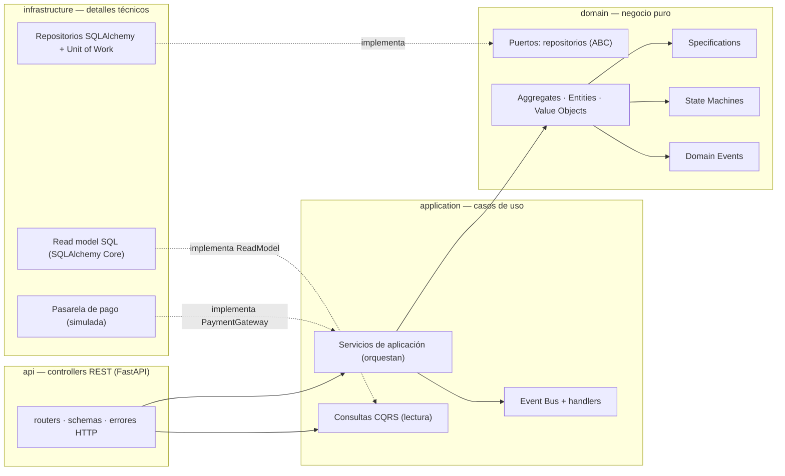
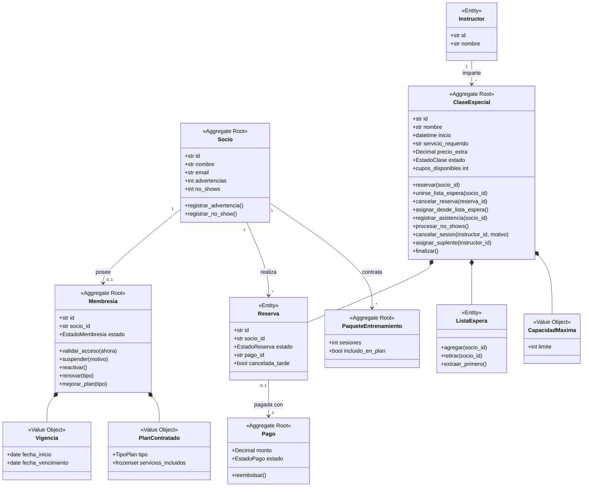
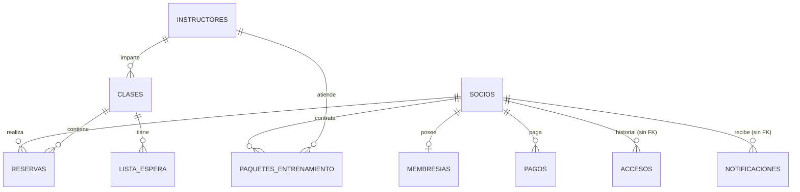
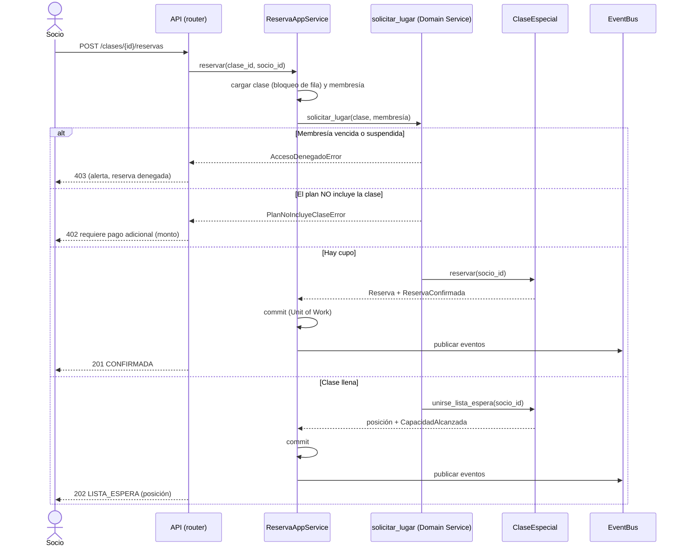
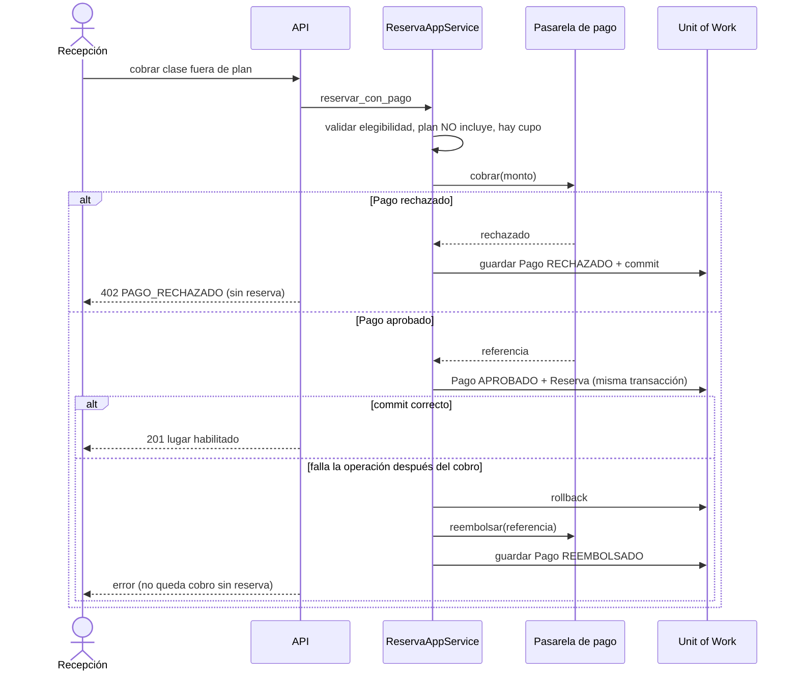
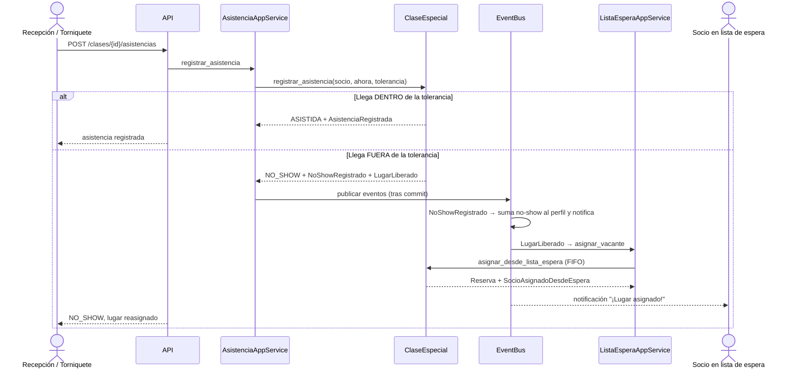

# Arquitectura de FitZone

Documento de decisiones técnicas. Los diagramas describen el **código final**; las decisiones están justificadas en los
[ADR](adr/README.md). Los diagramas de estados se generan desde el código ([state-machines.md](state-machines.md)).

## 1. Vista de capas (regla de dependencias)

La regla `api → application → domain ← infrastructure` se **verifica automáticamente** en
[`tests/unit/test_arquitectura.py`](../../tests/unit/test_arquitectura.py): si el dominio importa SQLAlchemy, FastAPI o
cualquier capa externa, la prueba falla (y por tanto el pipeline de CI).

| Capa | Carpeta | Responsabilidad | Prohibido |
|---|---|---|---|
| Dominio | `src/domain/` | Reglas de negocio, invariantes, eventos | Conocer BD, HTTP o frameworks |
| Aplicación | `src/application/` | Casos de uso: cargar → ordenar al dominio → guardar → publicar eventos | Contener `if cupos > 0` (esa regla vive en el dominio) |
| Infraestructura | `src/infrastructure/` | SQLAlchemy, UoW, read model, pasarela de pago, configuración | Contener reglas de negocio |
| API | `src/api/` | Endpoints REST, esquemas, traducción error → HTTP, *composition root* | Acceder a la BD directamente |

## 2. Modelo de dominio (DDD)

**Aggregate Roots:** `Socio`, `Membresia`, `ClaseEspecial`, `Pago`, `PaqueteEntrenamiento`. Los agregados se referencian
entre sí **solo por id** (`socio_id`, `pago_id`), nunca por objeto. `Reserva` y `ListaEspera` son entidades **internas** de
`ClaseEspecial`: no existen sin ella y solo ella puede crearlas (el equipo corrigió a la IA en este punto: ver bitácora de la Fase 2).
**Value Objects:** `Vigencia`, `PlanContratado`, `CapacidadMaxima` (inmutables, validan su invariante al crearse).
**Domain Service:** `solicitar_lugar` (`domain/services.py`) coordina `Membresia` + `ClaseEspecial`.
**Eventos de dominio:** ver `src/domain/events.py` (18 eventos; los publica el `EventBus` tras confirmar la transacción).

### Invariantes protegidos por los agregados

| Agregado | Invariante | Dónde |
|---|---|---|
| `ClaseEspecial` | Cupos disponibles ≥ 0 (nunca se excede la capacidad) | `reservar` → `CAPACIDAD_EXCEDIDA` |
| `ClaseEspecial` | Un socio no reserva dos veces la misma clase | `tiene_lugar` → `RESERVA_DUPLICADA` |
| `ClaseEspecial` | Una clase cancelada no admite reservas | estado + `CLASE_FSM` |
| `ListaEspera` | Orden estrictamente FIFO, sin duplicados | `agregar`, `extraer_primero` |
| `Membresia` | `fecha_vencimiento > fecha_inicio` | `Vigencia.__post_init__` |
| `Socio` | Datos de contacto válidos | `Socio.__init__` |
| `Pago` | Monto > 0; solo un pago aprobado puede reembolsarse | `Pago`, `PAGO_FSM` |

## 3. Persistencia (modelo físico)

Modelos ORM en `src/infrastructure/orm.py` (SQLAlchemy 2.0). Los repositorios traducen entre filas y objetos de dominio; el dominio nunca ve el ORM.

## 4. Flujos principales (secuencias del código final)

### 4.1 Reservar una clase (CU-02 / CU-03) — `POST /clases/{id}/reservas`

### 4.2 Cobro fuera de plan con compensación (CU-04) — `POST /clases/{id}/pagos-fuera-de-plan`

### 4.3 Asistencia, No-Show y asignación automática (US-05, US-07)

## 5. Patrones aplicados y justificación

| Patrón | Dónde | Por qué (relación con el negocio) |
|---|---|---|
| **Domain Model** | `src/domain/` | Las reglas de aforo, vigencia y lista de espera son muchas y están acopladas; encapsularlas evita duplicar validaciones (ADR 0001) |
| **Service Layer** | `src/application/*_service.py` | Una sola entrada por caso de uso que orquesta sin contener reglas |
| **Repository** | `domain/repositories.py` + `infrastructure/repositories.py` | El dominio no conoce la BD (ADR 0001, 0004) |
| **Unit of Work** | `infrastructure/unit_of_work.py` | Reserva + cobro + lista de espera deben guardarse juntas o ninguna (ADR 0002) |
| **CQRS** | `application/queries.py` + `infrastructure/read_model.py` | Los reportes de demanda no deben cargar agregados completos ni frenar el torniquete (ADR 0003) |
| **Specification** | `domain/specifications.py` | Reglas de acceso/reserva/cancelación como objetos componibles (`&`, `\|`, `~`) que explican por qué fallaron (ADR 0005) |
| **State Machine** | `domain/state_machine.py` | Membresía, reserva, clase y pago tienen ciclos de vida con transiciones válidas explícitas (ADR 0006) |
| **Domain Events + Event Bus** | `domain/events.py`, `application/event_bus.py`, `handlers.py` | "Se liberó un lugar" dispara la lista de espera sin acoplar los agregados (ADR 0007) |
| **Domain Service** | `domain/services.py` | La decisión de reservar involucra dos agregados |
| **Adapter / Gateway** | `PaymentGateway` → `PasarelaSimulada` | Se cambia por una pasarela real sin tocar el negocio (ADR 0008) |
| **Dependency Injection / Composition Root** | `api/container.py` | Único lugar donde se conectan implementaciones concretas |

Los principios SOLID, con evidencia en el código, están en [solid.md](solid.md).

## 6. Evolución respecto al diseño de la Fase 2

El diseño de la Fase 2 (`docs/entregas_previas/U3_Reporte_Fase2_Diseno_Arquitectural.pdf`) se mantuvo en lo esencial
(Domain Model, DDD, Service Layer, Repository, UoW, CQRS, ADR 0001–0003). Estos son los ajustes que se hicieron al
implementarlo y por qué; **el UML y las secuencias de la Fase 2 quedaron como versión inicial** (se conservan en
`diagramas_fase2/`) y los vigentes son los de este documento:

| Tema | En la Fase 2 | En la implementación | Motivo |
|---|---|---|---|
| Lenguaje | Interfaces estilo C# (`Task<...>Async`) y Dapper | Python 3.12: clases abstractas (`ABC`) y SQLAlchemy Core para lecturas | El curso y los laboratorios U4/U5 usan Python + FastAPI (ADR 0004) |
| Comandos CQRS | Clases `...Command` y `...CommandHandler` | Métodos de los servicios de aplicación | Simplificación; la separación escritura (dominio) / lectura (read model) se conserva |
| `ReporteMensualQuery(mes, año)` | Reporte por mes | `reporte_demanda(desde, hasta)` | US-10 E2 exige filtro por rango de fechas |
| `PagoAppService` | Servicio aparte | Función `ejecutar_con_cobro` reutilizada por 3 servicios | Evita triplicar la lógica de compensación |
| `Socio.estatus` | Atributo del socio (UML) | El estatus vive en `Membresia.estado` | Un único dueño del estado de acceso (US-06) |
| `Instructor.cancelarSesion()` | Método del instructor | `ClaseEspecial.cancelar_sesion(instructor_id, ...)` | Solo el agregado `ClaseEspecial` puede cambiar su estado; el instructor se verifica con una Specification (titular **o** suplente) |
| `Reserva` | Entidad interna de `ClaseEspecial` | Igual | Se mantuvo la corrección de la bitácora de IA |
| `NoShowRegistrado` | "Lo detona el sistema de recepción" | Lo emite `ClaseEspecial` (`procesar_no_shows` / `registrar_asistencia`) | El agregado es dueño de sus reservas |
| Plan con "Membresía Diamante" por polimorfismo (OCP) | `PlanContratado` polimórfico | Catálogo de datos `SERVICIOS_POR_PLAN` | Más simple; agregar un plan es agregar datos, no tocar servicios |
| Entrenamiento personal | Solo en el glosario | `PaqueteEntrenamiento` (US-13) | Estaba en el alcance del BRD y no tenía implementación |
| Modo offline (US-14 E2) | No tratado | Fuera de alcance (ADR 0009) | Requiere un cliente de torniquete con caché local |
