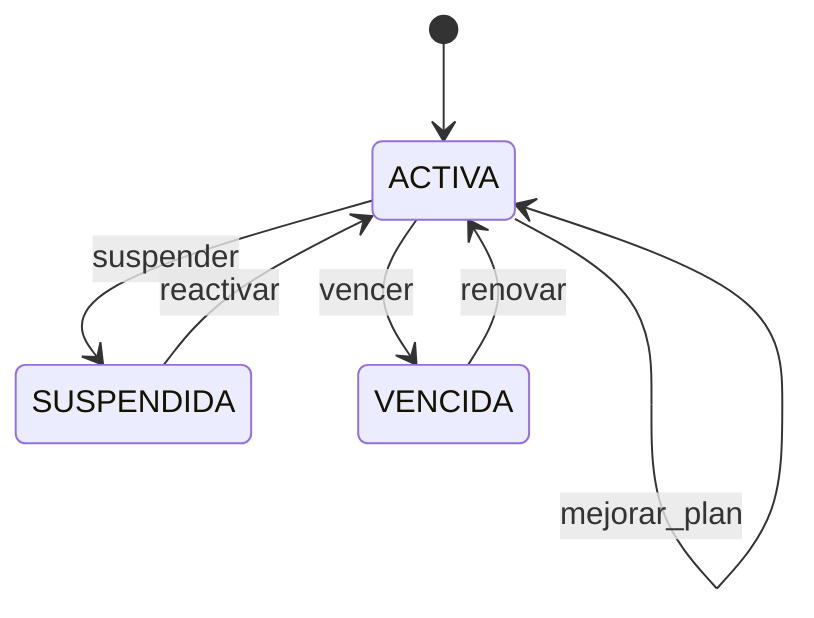
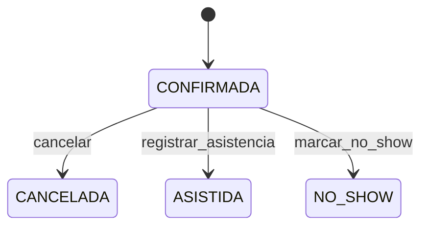
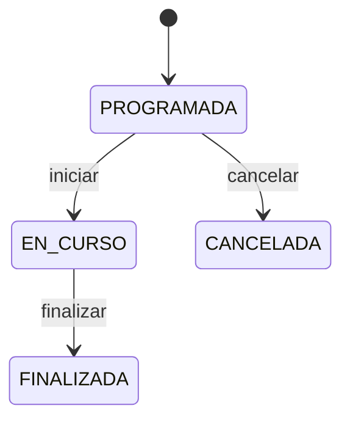
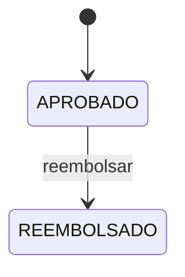

# Máquinas de estado (State Machine)

> Archivo **generado** por `scripts/generar_docs.py` a partir de las tablas de transición del código. No editar a mano.

## Membresía (US-01, US-06, US-11)

Definida en `src/domain/membresia.py`. El estado `VENCIDA` se recalcula con la fecha del sistema (`refrescar_estado`).

| Estado origen | Disparador | Estado destino |
|---|---|---|
| ACTIVA | `mejorar_plan` | ACTIVA |
| ACTIVA | `renovar` | ACTIVA |
| ACTIVA | `suspender` | SUSPENDIDA |
| ACTIVA | `vencer` | VENCIDA |
| SUSPENDIDA | `reactivar` | ACTIVA |
| VENCIDA | `renovar` | ACTIVA |

## Reserva (US-02, US-04, US-07)

Definida en `src/domain/clase_especial.py`. Solo una reserva `CONFIRMADA` puede cancelarse, asistir o marcarse como No-Show.

| Estado origen | Disparador | Estado destino |
|---|---|---|
| CONFIRMADA | `cancelar` | CANCELADA |
| CONFIRMADA | `marcar_no_show` | NO_SHOW |
| CONFIRMADA | `registrar_asistencia` | ASISTIDA |

## Clase especial (US-07, US-09)

Definida en `src/domain/clase_especial.py`. Una clase cancelada no admite reservas ni lista de espera.

| Estado origen | Disparador | Estado destino |
|---|---|---|
| EN_CURSO | `finalizar` | FINALIZADA |
| PROGRAMADA | `cancelar` | CANCELADA |
| PROGRAMADA | `iniciar` | EN_CURSO |

## Pago (US-12)

Definida en `src/domain/pago.py`. Un pago aprobado puede reembolsarse (compensación cuando falla la operación posterior).

| Estado origen | Disparador | Estado destino |
|---|---|---|
| APROBADO | `reembolsar` | REEMBOLSADO |
